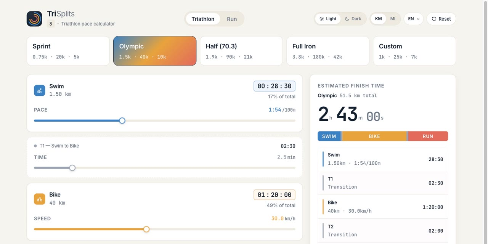
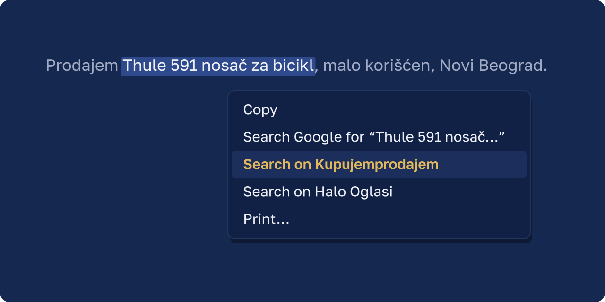

<picture>
  <source media="(max-width: 600px) and (prefers-color-scheme: dark)" srcset="assets/header-narrow-dark.svg">
  <source media="(max-width: 600px)" srcset="assets/header-narrow-light.svg">
  <source media="(prefers-color-scheme: dark)" srcset="assets/header-dark.svg">
  
</picture>

Over ten years of test automation for web, mobile and APIs. On the side I build small systems that watch things and report back: a camera that keeps an eye on my dog, a voice assistant for the family smart speaker, a bot that posts the lake temperature every morning.

Most of that code is private, so this page lists what I have built. Work history is on [LinkedIn](https://www.linkedin.com/in/akupratsevich/).

## Live projects

### [TriSplits](https://triathlon-calculator.online)

Finish-time and split estimator for every triathlon distance, in six languages. A static Next.js site with 30 pre-rendered pages, unit-tested pacing math and a small nginx deploy on a VPS.

`Next.js` `TypeScript` `Vitest`

Site: [triathlon-calculator.online](https://triathlon-calculator.online).

### [GTA VI Countdown for Garmin](https://gta6-garmin.belidor.cc)

A free watch face, glance and app for Garmin watches that tick down to the GTA VI release on 19 November 2026: days, hours, minutes and seconds, with a quiet always-on mode on AMOLED screens. Builds for 123 watch models, a landing page with a per-watch installer, and both apps in the Connect IQ Store.

`Monkey C` `Connect IQ` `GitHub Pages`

Site: [gta6-garmin.belidor.cc](https://gta6-garmin.belidor.cc). Source: [Belidor/gta6-countdown](https://github.com/Belidor/gta6-countdown), MIT.

### [Search on Kupujemprodajem](https://chromewebstore.google.com/detail/search-on-kupujemprodajem/eidkdejdckeneilcfpojkejjnnjnhkgb)

<a href="https://chromewebstore.google.com/detail/search-on-kupujemprodajem/eidkdejdckeneilcfpojkejjnnjnhkgb">
<picture>
  <source media="(prefers-color-scheme: dark)" srcset="assets/kupujemprodajem-dark.svg">
  
</picture>
</a>

A Chrome extension for life in Serbia: select any text on any page and search it on the country's two big classifieds sites, Kupujemprodajem and Halo Oglasi, straight from the context menu.

`JavaScript` `Chrome Extensions API`

Install: [Chrome Web Store](https://chromewebstore.google.com/detail/search-on-kupujemprodajem/eidkdejdckeneilcfpojkejjnnjnhkgb).

## Private projects

The source of these is private. Five run at home every day; three are finished and wait for a reason to ship.

| Project | What it does | Status |
| --- | --- | --- |
| Dog cam | Watches my dog through an IP camera. YOLO finds her, zones around the bowls and the sofa turn tracks into events, a local vision model describes them, Telegram gets the alerts. Runs on one Mac, no cloud. | `in use` |
| Family assistant for Alice | A private skill for the Yandex smart speaker. Answers with Claude, keeps the family calendar and shopping list, says when the next bus leaves. | `in use` |
| Belgrade weather bot | A daily Telegram post with the water temperature at Ada Ciganlija, air, wind and UV, cross-checked across several sources. | `in use` |
| Homework | A teacher uploads an HTML assignment and gets a link. Students fill it in on the page; the teacher sees each page as it was filled in. | `in use` |
| Claude Code mods | Plugins for my own workflow: continue a task after the usage limit resets, check replies against Simplified Technical English, drive Android devices for test runs. | `in use` |
| Cossacks in the browser | The 2002 strategy game in the browser through js-dos. The 610 MB bundle streams from a private Cloudflare R2 bucket behind a hard daily cap, so the bill stays at zero. | `built` |
| Lotto for Telegram | Classic Russian lotto as a Telegram Mini App, with rooms for seven players and automatic draws. | `built` |
| Photo Cleaner | An iOS app that turns clearing the camera roll into a swipe deck. Nothing is deleted until you confirm. | `built` |

## Toolbox

**Testing:** Playwright, TypeScript, XCUITest, Appium, CodeceptJS, Selenium, JMeter\
**Pipelines:** Jenkins, GitLab CI, GitHub Actions, Docker, PostgreSQL\
**Side projects:** Python, FastAPI, React, Next.js, Monkey C, YOLO, Ollama, Telegram Bot API, Vercel, Cloudflare, Supabase
